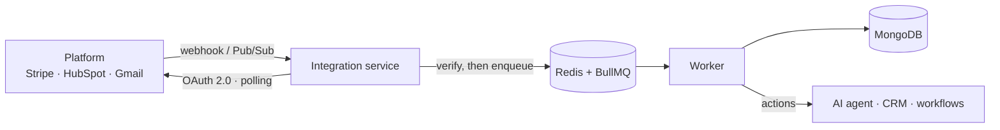

### Hi, I'm Divyansh 👋

I build the integrations that connect products to the platforms they depend on.
**This profile works like an API. Click an endpoint to call it.**

<details>
<summary> <code>/about</code> &nbsp;who I am</summary>
<br/>

```json
{
  "name": "Divyansh Sharma",
  "role": "Backend & Integration Engineer",
  "experience_years": 4,
  "location": "Bengaluru, India",
  "focus": ["third-party API integrations", "OAuth 2.0", "webhooks", "queues and workers"],
  "stack": ["Node.js", "Python", "Express", "MongoDB", "Redis", "BullMQ", "Docker", "Google Cloud"],
  "certifications": ["Google Cloud Digital Leader"],
  "education": "B.Tech, Presidency University, Bangalore"
}
```
</details>

<details>
<summary> <code>/integrations</code> &nbsp;20+ platforms I've shipped</summary>
<br/>

| Domain | Platforms |
|---|---|
| 💳 Payments | Stripe Connect (OAuth, webhook signature verification, multi-account) |
| 🤝 CRM & legal | HubSpot, Clio |
| 🏥 Healthcare | Athenahealth, eClinicalWorks (via NexHealth) |
| 🏨 Hospitality | Cloudbeds |
| 📅 Scheduling | Cal.com, Calendly |
| 📧 Email & data | Gmail (Pub/Sub), Google Sheets, BigQuery |
| 📈 Ads | Google Ads, Meta Conversions API |
| 💬 Social | Instagram, Facebook, YouTube |
| ⚙️ Automation | Make.com custom connector app |

</details>

<details>
<summary> <code>/architecture</code> &nbsp;the pattern behind most of them</summary>
<br/>


</details>

<details>
<summary> <code>/projects</code> &nbsp;things I've built in the open</summary>
<br/>

- **[calendlyIntegration](https://github.com/divyanshsharma11/calendlyIntegration)** — the architecture above, end to end: OAuth2, event sync, webhook intake and BullMQ workers. Node.js · Express · MongoDB · Docker
- **[luduscore](https://github.com/divyanshsharma11/luduscore)** — a Python package that ranks games with transparent, rule-based scoring instead of a black-box model. Tested.
- **[hubSpot-Integration](https://github.com/divyanshsharma11/hubSpot-Integration)** — syncs HubSpot contacts to MongoDB and sends notification emails.

</details>

<details>
<summary> <code>/experience</code> &nbsp;where I've worked</summary>
<br/>

```json
[
  { "company": "M32 AI", "role": "Integration Engineer",
    "built": "integrations for an AI voice receptionist, chat agent and workflow builder" },
  { "company": "Vodex AI", "role": "Software Developer",
    "built": "Cal.com, Gmail, Google Sheets and HubSpot integrations; Redis + BullMQ (30% faster)" },
  { "company": "Capgemini Engineering", "role": "Associate → Associate II Software Engineer",
    "built": "Node.js microservices, BigQuery audit logging, Python automation" }
]
```
</details>

<details>
<summary> <code>/fun-fact</code></summary>
<br/>

```json
{ "fact": "I code with music on. It keeps the bugs away, most of the time." }
```
</details>

<details>
<summary> <code>/hire</code> &nbsp;open to backend & integration roles</summary>
<br/>

```http
HTTP/1.1 201 Created
Location: https://www.linkedin.com/in/divyansh-sharma1121
```

👉 **[Let's talk on LinkedIn](https://www.linkedin.com/in/divyansh-sharma1121)** · Bengaluru or remote

</details>
