I build the integrations that connect products to the platforms they depend on, and the backend services behind them.<br/>
**This profile works like an API. Click an endpoint to call it.**

<details>
<summary><picture>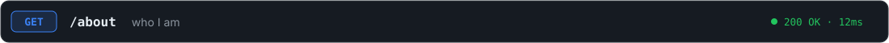</picture></summary>
<br/>

```json
{
  "name": "Divyansh Sharma",
  "role": "Backend & Integration Engineer",
  "experience_years": 4,
  "location": "Bengaluru, India",
  "focus": ["third-party API integrations", "OAuth 2.0", "webhooks", "queues and workers", "backend services"],
  "stack": ["Node.js", "Python", "Express", "MongoDB", "SQL", "Redis", "BullMQ", "Docker", "Google Cloud"],
  "certifications": ["Google Cloud Digital Leader"],
  "education": "B.Tech, Presidency University, Bangalore"
}
```
</details>

<details>
<summary><picture>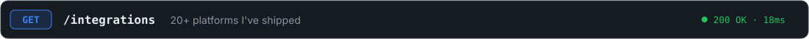</picture></summary>
<br/>

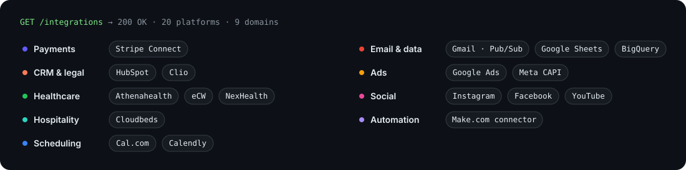

<sub>eCW = eClinicalWorks · CAPI = Meta Conversions API</sub>
</details>

<details>
<summary><picture></picture></summary>
<br/>

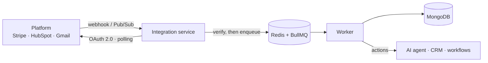
</details>

<details>
<summary><picture>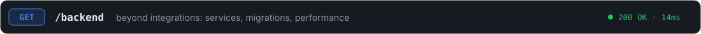</picture></summary>
<br/>

- **Microservices** — led the Node.js upgrade across microservices with minimal downtime, and moved from Moment.js to Day.js to cut bundle size.
- **Data** — migrated text-file data into databases with Java and SQL, added automated schedulers for periodic updates, and built audit logging into BigQuery.
- **Performance** — Redis caching and BullMQ job queues that made the system 30% faster.
- **APIs & auth** — RESTful APIs, standardized JSON API templates, and JWT authentication middleware.
- **Python** — event-driven functions that automate email processing and blacklist management.

</details>

<details>
<summary><picture>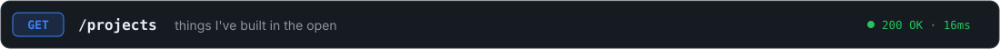</picture></summary>
<br/>

<p>
<a href="https://github.com/divyanshsharma11/calendlyIntegration">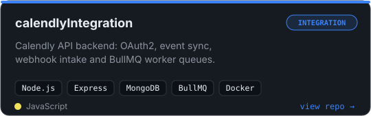</a>
<a href="https://github.com/divyanshsharma11/hubSpot-Integration">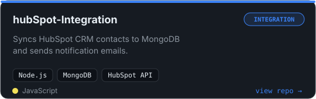</a>
<a href="https://github.com/divyanshsharma11/luduscore">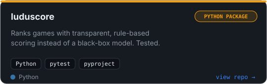</a>
<a href="https://github.com/divyanshsharma11/fetchAndSendStock">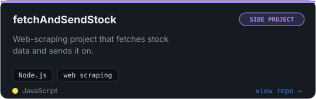</a>
<a href="https://github.com/divyanshsharma11/STONKS-WEBAPP">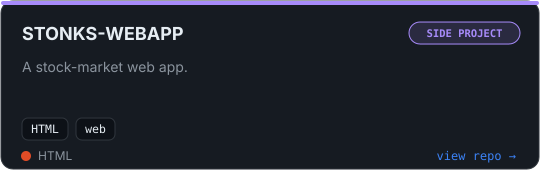</a>
<a href="https://github.com/divyanshsharma11/MACHINE_LEARNING_STOCK_PREDICTION_MODEL">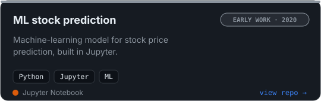</a>
</p>

</details>

<details>
<summary><picture>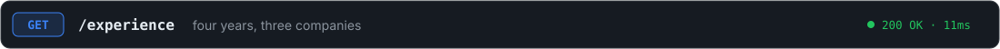</picture></summary>
<br/>

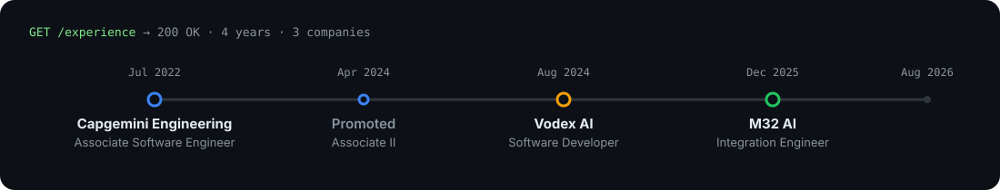

**M32 AI** · Integration Engineer
- Built a Make.com connector app from scratch (OAuth2, webhook and polling triggers)
- Stripe Connect with webhook signature verification and multi-account support
- Healthcare (Athenahealth, eClinicalWorks via NexHealth) and hospitality (Cloudbeds) integrations for an AI voice receptionist and chat agent

**Vodex AI** · Software Developer
- Cal.com, Gmail, Google Sheets and HubSpot integrations
- Redis caching and BullMQ queues, 30% faster
- JWT authentication middleware

**Capgemini Engineering** · Associate → Associate II Software Engineer
- Led a Node.js upgrade across microservices
- Asynchronous message auditing with data in BigQuery
- Event-driven Python automation

</details>

<details>
<summary><picture></picture></summary>
<br/>

```json
{ "fact": "I code with music on. It keeps the bugs away, most of the time." }
```
</details>

<a href="https://www.linkedin.com/in/divyansh-sharma1121">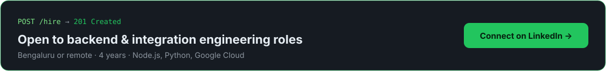</a>
